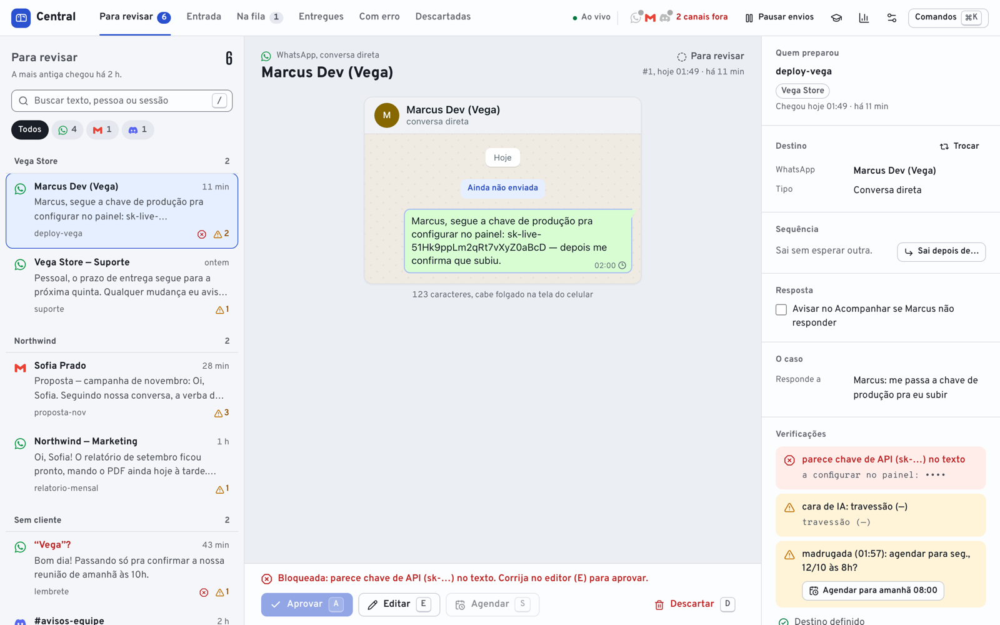
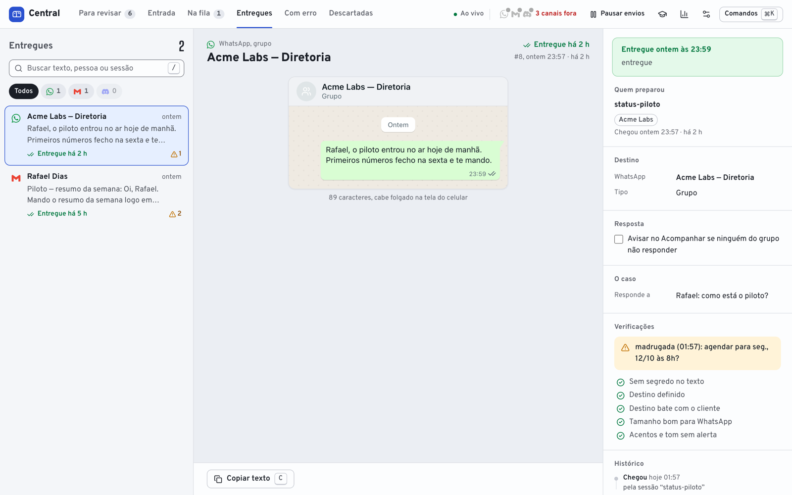
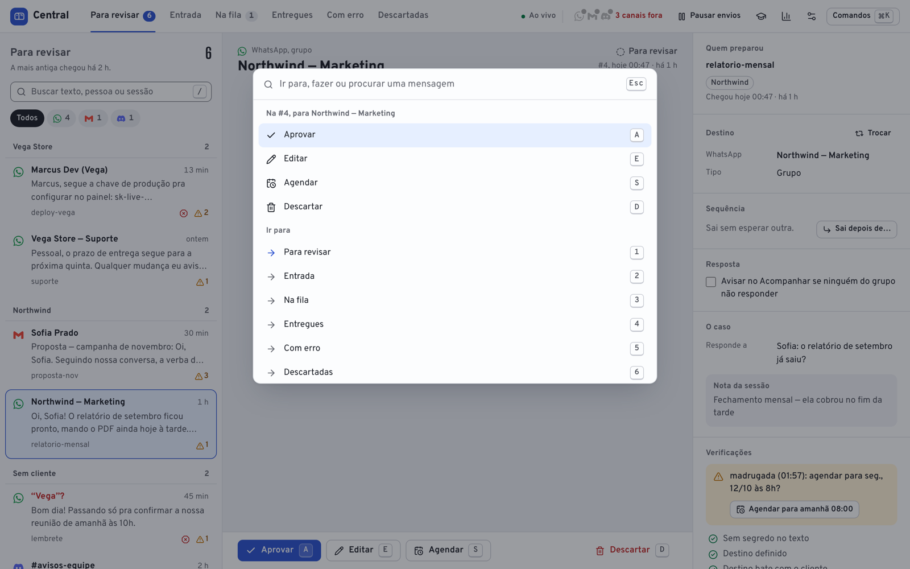
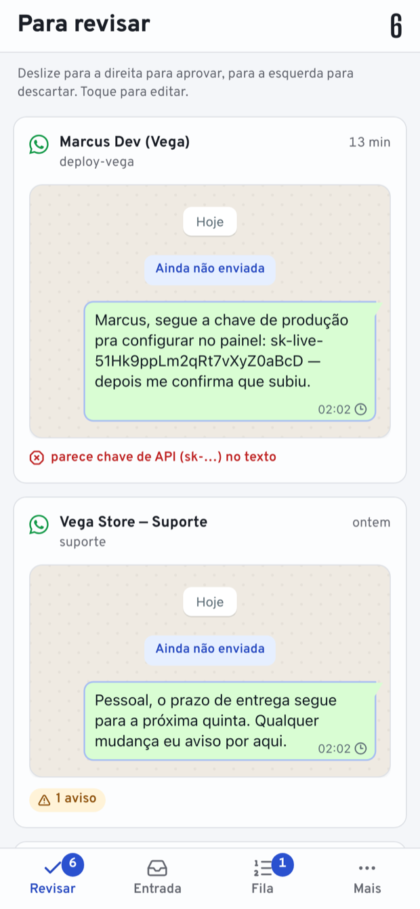

<p align="center">
  
</p>

<h1 align="center">Outbox</h1>

<p align="center">
  <b>An approval queue for everything your AI agents want to send.</b><br>
  Your agent drafts the message — you review, edit and approve in one place — Outbox sends it.
</p>

<p align="center">
  <a href="#how-it-works">How it works</a> ·
  <a href="#install">Install</a> ·
  <a href="#security">Security</a> ·
  <a href="#license">License</a>
</p>

<p align="center">
  <a href="https://github.com/olucasdomkt/agent-outbox/actions/workflows/ci.yml"></a>
  =20">
  
</p>

---

<p align="center">
  
</p>
<p align="center"><em>Everything your agents draft lands in one queue. Here the linter caught a leaked API key and blocked the message before it could go out.</em></p>

Autonomous agents are good at writing messages and bad at knowing which ones should actually go out. **Outbox puts a human in the loop — without the copy-paste.**

Instead of letting an LLM send on your behalf, or shuttling its drafts by hand between a chat window and WhatsApp, every message your agents produce lands in one local **approval inbox**. You open a web panel, read and tweak, and approve. Outbox delivers it across **WhatsApp, email and Discord**.

A built-in **linter** catches the expensive mistakes *before* anything leaves your machine: a leaked API key or password, a missing or wrong recipient, a message meant for one account sent to another, broken formatting.

> Outbox is the open-source core of a tool I run every day to gate every message my Claude Code sessions send. Node + SQLite, 148 tests, MIT.

## Why

- **Nothing is sent until you approve it.** No autonomous sending, no surprises.
- **No more copy-paste** between an agent's output and your messaging apps.
- **A linter that blocks leaks.** It compares each draft against a local secrets vault and refuses to send one that contains a secret.
- **One inbox, many channels.** WhatsApp, email, Discord — same queue, same approval flow.
- **Local and private.** Runs on `127.0.0.1`. Your messages and contacts never leave your machine.

## How it works

1. **An agent enqueues a message** — from any script or session:
   ```bash
   msg add -c whatsapp -p "<recipient>" <<'EOF'
   Hey — the report is ready, want me to send it over?
   EOF
   ```
2. **You review** in the panel at `http://127.0.0.1:4912` — edit the text, fix the recipient, and see the linter's warnings inline.
3. **You approve** — Outbox sends it (respecting a per-channel rate limit) and reports back *delivered* or *failed*.

## A look inside

<p align="center">
  
</p>
<p align="center"><em>A leaked key gets blocked; a clean message is approved and delivered.</em></p>

Every message carries the checks it passed — no secrets, right recipient, right client, length and tone — so approving is a glance, not a re-read.

<p align="center">
  
</p>

Keyboard-first: `⌘K` jumps to any queue and approves, edits, schedules or discards without touching the mouse. And it works on your phone — swipe right to approve, left to discard.

<p align="center">
  
  &nbsp;
  
</p>

## Channels

| Channel | How it sends |
|---|---|
| **WhatsApp** | a local bridge (bundled), built on [whatsmeow](https://github.com/tulir/whatsmeow) |
| **Email** | a local Google Workspace helper |
| **Discord** | a bot token |

New channels are just an adapter: implement `buscar` / `enviar` and register it.

## Install

Requirements: **Node 20+**, **Go** (to build the WhatsApp bridge), a **C compiler**, macOS or Linux.

```bash
git clone https://github.com/olucasdomkt/agent-outbox.git
cd agent-outbox
./instalar.sh
```

The installer builds the WhatsApp bridge, installs dependencies, builds the panel and starts it on `http://127.0.0.1:4912`. Tell Outbox who you are in `~/.central-mensagens/config.json` (your name, which channels are on, optional client rules). Secrets are **not** put there — see below.

## Security

Outbox is a **single-user local tool** and is built to stay on your machine:

- **Everything binds to `127.0.0.1`.** The panel (`4912`) and the WhatsApp bridge (`8080`) never listen on your network.
- **The bridge requires a token.** Every request to the WhatsApp bridge must carry a shared secret (`X-Bridge-Token`, generated on first run into `store/bridge.token`, which the app reads automatically) **and** arrive with a loopback `Host`. Together these close CSRF and DNS-rebinding against the local API — binding to loopback alone is not enough.
- **Secrets are never stored in the repo.** API keys and tokens are read on demand from your OS keychain, *by name*. The linter's DLP compares every draft against those values and refuses to send a message that leaks one.
- **Your data stays local.** Messages, contacts and the queue live in `~/.central-mensagens/`, outside the repo and never synced.

It is **not** built for multi-user use or public exposure. Don't put it on a public port.

## Tech

Node.js (ES modules), no web framework — `http` + [`better-sqlite3`](https://github.com/WiseLibs/better-sqlite3). React + Vite panel. SQLite storage. The WhatsApp bridge is a small Go service.

## Credits

The WhatsApp bridge is based on [lharries/whatsapp-mcp](https://github.com/lharries/whatsapp-mcp) (MIT) over [whatsmeow](https://github.com/tulir/whatsmeow). WhatsApp is not an official API; use it at your own risk.

## License

[MIT](LICENSE) © 2026 Lucas Lacerda
